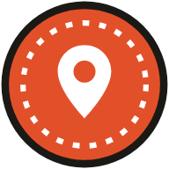
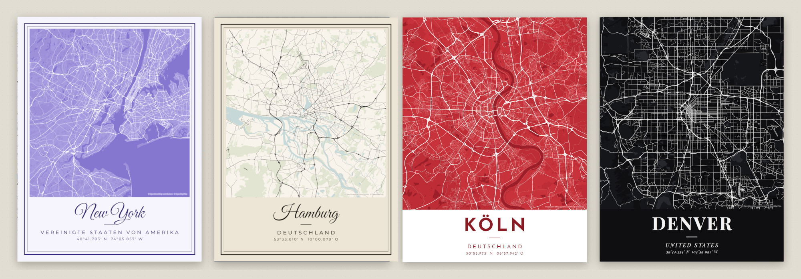
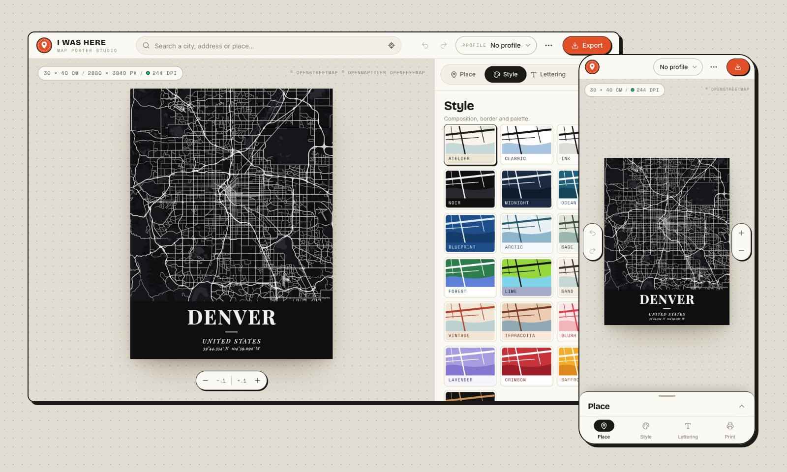

<p align="center">
  
</p>

<h1 align="center">I Was Here</h1>

<p align="center">
  Turn any place on earth into a minimalist map poster
</p>




Search for a city, pick a look, give it a title and download a print-ready file. Print it at home, send it to a
print shop, put it on a T-shirt. It's yours, and it's free.

## What you get

- **Any place on earth**, drawn from OpenStreetMap
- **8 layouts, 19 color palettes and 10 typefaces**, or mix your own colors
- **Print-ready files:** PNG, JPEG or PDF, from Full HD up to 8K or 300 DPI (different sizes)
- **Profiles:** save a look once and use it for every place. They're small files you can back
  up and share.
- **Made for phones too:** supports installation (PWA)
- English / German
- Light & dark mode



## Install

All you need is [Docker](https://docs.docker.com/get-docker/). 

One command:

```bash
docker run -d --name i-was-here -p 3000:3000 --restart unless-stopped ghcr.io/dev-nick421/i-was-here:latest
```

Open <http://localhost:3000>, or `http://<your-server>:3000` from any other device.

### Docker Compose

```bash
mkdir i-was-here && cd i-was-here
curl -fsSLO https://raw.githubusercontent.com/dev-nick421/i-was-here/main/docker-compose.yml
docker compose up -d
```

Want another port? Put `PORT=8080` into a `.env` file next to `docker-compose.yml`.

### Unraid

1. Open the Unraid terminal (the `>_` icon at the top right) and paste:

   ```bash
   wget -O /boot/config/plugins/dockerMan/templates-user/my-i-was-here.xml \
     https://raw.githubusercontent.com/dev-nick421/i-was-here/main/deploy/unraid/i-was-here.xml
   ```

2. Go to **Docker → Add Container**, pick **i-was-here** in the *Template* list, choose a port
   and click **Apply**.
3. Click the container's icon → **WebUI**.

<details>
<summary>Without the template</summary>

**Docker → Add Container**, then set *Name* to `i-was-here` and *Repository* to
`ghcr.io/dev-nick421/i-was-here:latest`. Click **Add another Path, Port, Variable…**, choose
*Port*, set the container port to `3000` and the host port to whatever you like. **Apply**.

</details>

### Raspberry Pi

Works on the Raspberry Pi 3, 4, 5 and Zero 2 W with the 64-bit Raspberry Pi OS (the default in
Raspberry Pi Imager). There's an image for older Pis and 32-bit systems too. No Docker yet?

```bash
curl -fsSL https://get.docker.com | sh
sudo usermod -aG docker $USER   # then log out and back in
```

Now run the `docker run` command from above. The Pi only serves the app; the posters are drawn
on the phone or computer you design them on, so even a small Pi is plenty.

### Docker Desktop (Windows and macOS)

Install [Docker Desktop](https://www.docker.com/products/docker-desktop/), open a terminal
(PowerShell, Terminal, or the one built into Docker Desktop), run the `docker run` command from
above and open <http://localhost:3000>.

### Updating

```bash
docker pull ghcr.io/dev-nick421/i-was-here:latest
docker rm -f i-was-here    # then start it again with the docker run command
```

With Compose: `docker compose pull && docker compose up -d`. On Unraid: **Docker → Check for
Updates**. Your profiles live in your browser, so updates never touch them.

## Use it as an app

On your phone or computer, open the editor and choose **⋯ → Install app** (iPhone and iPad:
**Share → Add to Home Screen**). I Was Here gets its own icon and window and opens even without
a connection.

Browsers only install apps from `https://` addresses or from `localhost`. If you run it on a
home server over plain `http://`, everything else works, but for installing you need HTTPS in
front of it, for example with Nginx Proxy Manager, Caddy or Tailscale.
[Here's how](docs/self-hosting.md#https-and-installing-the-app).

## Settings

Everything works out of the box. If you want to change something:

| Variable | What it does |
| --- | --- |
| `PORT` | The port on your machine when you use Compose (default `3000`) |
| `NUXT_PUBLIC_MAP_TILES_URL` | Use other or self-hosted map tiles |
| `NUXT_GEOCODER_PROVIDER` | Place search with `photon` (default) or `nominatim` |
| `NUXT_GEOCODER_URL` | Use your own place search server |

All settings are explained in [`.env.example`](.env.example) and the
[self-hosting guide](docs/self-hosting.md).

## Profiles

A profile remembers the look of a poster: 
- layout
- colors
- typeface
- map details
- print settings

Save one from the profile menu and apply it to any other place. Download your
profiles as JSON to back them up or share them, and drop a file onto the editor to import it.
Theres a few examples in [`profiles/`](profiles).

## Printing tips

- Print shops like 300 DPI. Big posters that hang on a wall look great at 150 DPI too.
- The editor shows the DPI and a little quality dot for every size and resolution.
- PNG is lossless. PDF has the exact paper size, which some print shops prefer.

## Credits

Map data © [OpenStreetMap](https://www.openstreetmap.org/copyright) contributors (ODbL), map
tiles by [OpenFreeMap](https://openfreemap.org), place search by
[Photon](https://photon.komoot.io). Typefaces under the SIL Open Font License via
[Fontsource](https://fontsource.org). Posters carry a small OpenStreetMap credit by default.
Please keep it, or credit OpenStreetMap somewhere else, like on the back of the print.

## Contributing

Ideas, bug reports, new palettes and translations are very welcome.
[CONTRIBUTING.md](CONTRIBUTING.md)

## License

[MIT](LICENSE) dev-nick421
